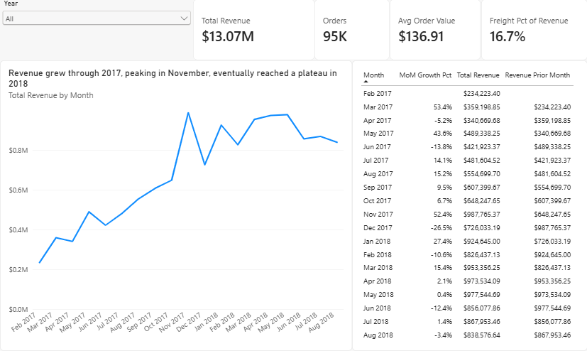
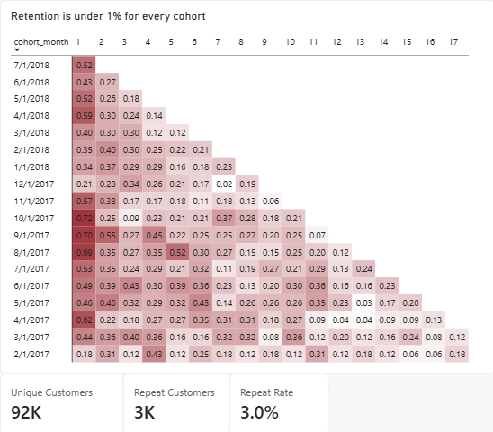
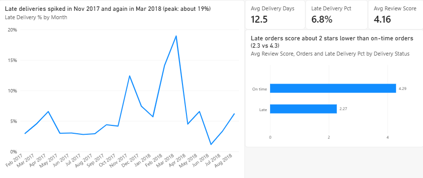
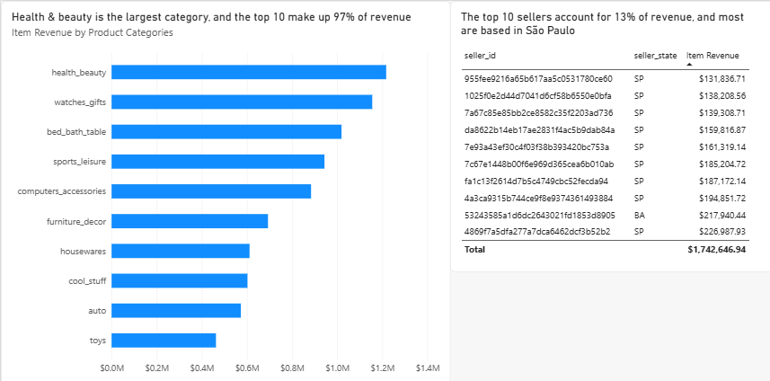

# Olist Business Intelligence Suite

> SQL Server, Excel, and Power BI analysis of about 95K Olist e-commerce orders: revenue, retention, delivery performance, and sellers.

## Overview

Olist is a Brazilian online marketplace that connects small businesses with customers across the country. This project treats me as the analyst supporting Olist's leadership team. It starts from nine raw CSV files and ends with a four-page Power BI dashboard and a written summary of findings and recommendations.

The questions it answers:

1. How have revenue and order volume changed over time?
2. Which product categories drive revenue?
3. Do customers come back after their first purchase?
4. How often are deliveries late, and what does lateness do to review scores?
5. How concentrated is revenue across sellers?
6. How do customers pay, and how much does freight add?

## Key Findings

Numbers cover delivered orders from February 2017 to August 2018 (see [Analysis Rules](#analysis-rules)). Revenue is item price only, in Brazilian reais.

| Area | Finding |
|---|---|
| Revenue | 13.07M total across about 95K orders. Revenue climbed through 2017, peaked in November 2017 (about 0.99M), then held between roughly 0.83M and 0.98M per month in 2018. |
| Order value | Average order value is 136.91. Freight adds 16.7% on top of item revenue. |
| Retention | Month-1 retention is below 1% in every cohort (0.18% to 0.72%). Only 3.0% of customers (about 3K of 92K) placed more than one order. Growth comes from new customers, not repeat buying. |
| Delivery | 6.8% of orders arrive late, and delivery takes 12.5 days on average. Late deliveries spiked in November 2017 (about 12%) and March 2018 (about 19%). |
| Reviews | On-time orders average 4.29 stars and late orders 2.27, a gap of about 2 stars. |
| Categories | Health & beauty is the largest category. The top 10 categories make up **[X]%** of revenue. |
| Sellers | The top 10 sellers account for **[X]%** of revenue, and **[X] of [Y]** sellers generate 80% of it. |

## Analysis Rules

Every analysis query and dashboard measure uses the same base view (`vw_order_revenue`):

- **Status:** delivered orders only (97% of all orders).
- **Window:** February 2017 through August 2018. Earlier months have very few orders (late 2016 is sparse, and November 2016 is missing), and September 2018 is incomplete.
- **Orphan orders:** 775 orders have no item rows and are excluded, since they have no price.
- **Revenue:** item price only. Freight is reported separately.
- **Delivery metrics:** 8 delivered orders have no delivery date, so they are excluded from delivery calculations only.
- **Late:** an order is late if its delivery date is after the estimated date. Times of day are ignored.

## Dashboard

| Page | What it shows |
|---|---|
| Executive Summary | Revenue, orders, average order value, freight share, monthly revenue, and month-over-month growth |
| Customers | Unique customers, repeat rate, and a cohort retention heatmap |
| Operations | Late delivery rate, delivery time, review score by delivery status, and late rate by month |
| Sellers and Products | Top 10 categories and top 10 sellers by revenue |






## Tech Stack

| Purpose | Tool |
|---|---|
| Database and analysis | SQL Server 2025 Express (T-SQL: CTEs, window functions, views) |
| Exploration | Excel |
| Dashboard | Power BI Desktop (star-schema model, DAX measures) |
| Project tracking | GitHub Projects |

## Repository Structure

```
olist-bi-suite/
├── data/raw/              (CSVs, gitignored)
├── sql/
│   ├── 01_schema.sql      tables and keys
│   ├── 02_load.sql        BULK INSERT from CSVs
│   ├── 03_cleaning.sql    data quality checks, with findings
│   └── 04_analysis/
│       ├── 01_base_view.sql
│       ├── 02_monthly_revenue.sql
│       ├── 03_categories.sql
│       ├── 04_customers.sql
│       ├── 05_delivery.sql
│       ├── 06_sellers_finance.sql
│       └── 07_cohort_view.sql
├── excel/
├── powerbi/olist-dashboard.pbix
├── docs/                  screenshots and summary.md
└── README.md
```

## How to Reproduce

1. Download the [Olist dataset](https://www.kaggle.com/datasets/olistbr/brazilian-ecommerce) and place the CSVs in `data/raw/`.
2. Install SQL Server Express and create a database named `olist`.
3. Run `01_schema.sql`, then `02_load.sql` (update the file paths to match your machine).
4. Run `03_cleaning.sql` to check the load, then the files in `04_analysis/`.
5. Open `powerbi/olist-dashboard.pbix`, point the data source at your SQL Server instance, and refresh.

## Limitations

- "First purchase" in the retention analysis means the first purchase inside the analysis window, so some returning customers appear as new.
- Late deliveries and low review scores move together in this data. That doesn't show that lateness causes the lower scores.
- Retention counts in later months are small, so month-to-month changes there are mostly noise.
- Revenue excludes freight and orders outside the window or without items.
- The currency may be misleading as the currency are mostly in Brazilian reais instead of $, and it hasn't been converted.

## Data Source

[Brazilian E-Commerce Public Dataset by Olist](https://www.kaggle.com/datasets/olistbr/brazilian-ecommerce) on Kaggle.
